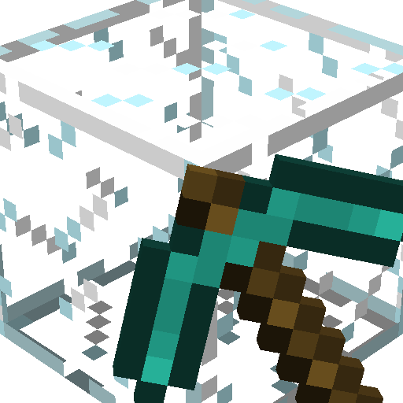

<!-- BetaDrop animated logo loaded from the remote repository. -->
<p align="center">
  
</p>

<h1 align="center">BetaDrop</h1>

<p align="center">Held-item-aware custom drops for Minecraft Beta 1.7.3 / Project Poseidon</p>

<p align="center">
  
  
  
</p>

<p align="center"><b>English</b> · <a href="README-zh.md">简体中文</a></p>

BetaDrop is a Minecraft Beta 1.7.3 plugin that creates custom drops based on the player's held item, the broken block, and their data values. It is suitable for special gathering mechanics, ore conversion, tool-specific output, and dye-to-wool recipes on Beta 1.7.3 servers.

BetaDrop does not change native harvest levels. It only takes control of a matching drop after a block break event has successfully been triggered.

## Compatibility

| Component | Requirement |
| --- | --- |
| Server | [Project Poseidon](https://github.com/retromcorg/Project-Poseidon) / Minecraft Beta 1.7.3 |
| Java | Java 8 compilation target |
| Bukkit API | Poseidon / CraftBukkit Beta 1.7.3 |

## Directory Structure

```text
plugins/
└── BetaDrop/
    └── rules.txt
```

## Rule Format

```text
# Format: Held item|Block|Drops*amount[,Drops*amount...]
# 格式: 手持物品|方块|掉落物*数量[,掉落物*数量...]
```

Default rules:

```text
Wood pickaxe on cobblestone → 1 mossy cobblestone
Wood pickaxe on ice → 1 ice
Wood pickaxe on diamond ore → 1 diamond ore
Wood pickaxe on coal ore → 1 coal ore
Wood pickaxe on glowing redstone ore → 1 redstone ore
Wood pickaxe on lapis ore → 1 lapis ore
Wood pickaxe on furnace → 1 burning furnace
Wood shovel on snow layer → 1 snow layer
Gold axe on log → 2 logs
Gold shovel on sand → 2 sand
Gold shovel on clay → 2 clay blocks
Holding dye while mining white wool → drops wool of the corresponding color
```

## Configuration Validation

BetaDrop validates rules during startup and prints English diagnostic messages. Failure examples:

```text
[BetaDrop] rules.txt line 18: unknown material 'LAPIS_OR'
[BetaDrop] rules.txt line 22: drop amount must be between 1 and 64
[BetaDrop] rules.txt line 30: duplicate rule from line 25; the later rule replaces it
```

Example of a successful load:

```text
[BetaDrop] loaded 26 rules.
```

If there are no valid rules, the plugin remains enabled but does not take control of any block drops, and prints:

```text
[BetaDrop] no valid rules loaded; custom drops are disabled.
```

## Sponsorship and Support

If this project is useful to you, you can support development through Ko-fi or Afdian. Sponsors can receive help with installation, configuration, and troubleshooting.

<p align="center">
  <a href='https://ko-fi.com/J5C529ZWWL' target='_blank'></a>
  <a href='https://afdian.com/a/sss000' target='_blank'></a>
</p>