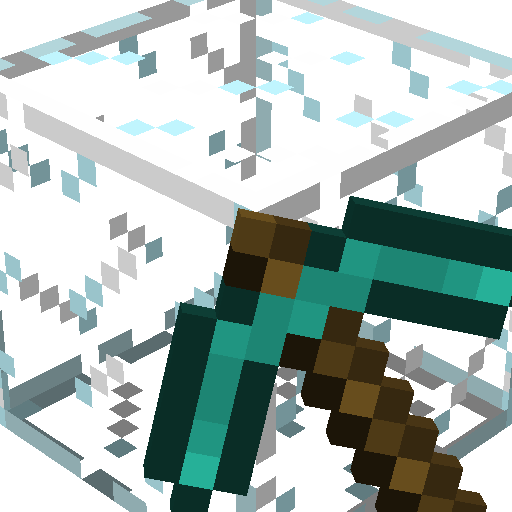

<!-- BetaDrop animated logo. -->
<p align="center">
  
</p>

<h1 align="center">BetaDrop</h1>

<p align="center">面向 Minecraft Beta 1.7.3 / Project Poseidon 的手持物品感知自定义掉落插件</p>

<p align="center">
  
  
  
</p>

<p align="center"><a href="README.md">English</a> · <b>简体中文</b></p>

BetaDrop 是一个可根据玩家手持物品、被破坏方块及其数据值生成自定义掉落的Beta1.7.3插件。它适合制作 Beta 1.7.3 服务器中的特殊采集玩法、矿物转换、工具限定产出和染料与羊毛转化。

插件不修改原版采集等级。只有方块破坏事件成功触发后，BetaDrop 才会接管匹配规则的掉落。


## 兼容性

| 项目 | 要求 |
| --- | --- |
| 服务端 | [Project Poseidon](https://github.com/retromcorg/Project-Poseidon) / Minecraft Beta 1.7.3 |
| Java | Java 8 编译目标 |
| Bukkit API | Poseidon / CraftBukkit Beta 1.7.3 |
|  |

## 目录结构

```text
plugins/
└── BetaDrop/
    └── rules.txt
```

## 规则格式

```text
# Format: Held item|Block|Drops*amount[,Drops*amount...]
# 格式: 手持物品|方块|掉落物*数量[,掉落物*数量...]
```

默认规则：

```text
木镐采圆石 → 1 个苔石
木镐采冰 → 1 个冰
木镐采钻石矿 → 1 个钻石矿
木镐采煤矿 → 1 个煤矿
木镐采发光的红石矿 → 1 个红石矿
木镐采青金石矿 → 1 个青金石矿
木镐采熔炉 → 1 个燃烧中的熔炉
木铲采雪层 → 1 个雪层
金斧采原木 → 2 个原木
金铲采沙子 → 2 个沙子
金铲采黏土块 → 2 个黏土块
手持染料挖掘白色羊毛 → 掉落对应颜色的羊毛

```


## 配置检查

BetaDrop 在启用时检查规则并输出英文诊断信息。失败示例：

```text
[BetaDrop] rules.txt line 18: unknown material 'LAPIS_OR'
[BetaDrop] rules.txt line 22: drop amount must be between 1 and 64
[BetaDrop] rules.txt line 30: duplicate rule from line 25; the later rule replaces it
```

实际加载结果示例：

```text
[BetaDrop] loaded 26 rules.
```

如果没有任何有效规则，插件会保持启用状态，但不会接管任何方块掉落，并输出：

```text
[BetaDrop] no valid rules loaded; custom drops are disabled.
```

## 赞助与支持

如果本项目对你有帮助，可以通过 Ko-fi 或爱发电赞助开发。赞助后可提供插件安装、配置和故障排查等问答服务。

<p align="center">
  <a href='https://ko-fi.com/J5C529ZWWL' target='_blank'></a>
  <a href='https://afdian.com/a/sss000' target='_blank'></a>
</p>